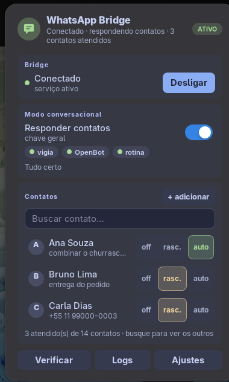

# wpp — WhatsApp para agentes

Ferramenta pessoal para um agente (Claude Code, OpenBot) **ler, enviar e responder** mensagens do **seu** WhatsApp, com travas de segurança no código, modo conversacional por contato e um painel no GNOME. Conecta direto na sua conta pela API multi-dispositivo (biblioteca [whatsmeow](https://github.com/tulir/whatsmeow)); tudo roda local e o histórico fica em SQLite no seu computador.

> **Origem.** Este projeto nasceu como cópia de [lharries/whatsapp-mcp](https://github.com/lharries/whatsapp-mcp) (MIT, © Luke Harries), mas **deixou de ser um fork** e hoje é outra ferramenta. Do original sobrou o **bridge em Go** (conexão com o WhatsApp), modificado: cerca de 85% das linhas do `main.go` ainda vêm dele, e ele não deixa de ser a base. Todo o resto é novo: o comando `wpp`, a skill, as travas de envio, a agenda, o modo conversacional, o vigia, a sessão ao vivo e o indicador do GNOME. O servidor MCP original (reescrito por aqui) está **arquivado** em `_arquivo/mcp/`. O repositório original fica como referência (remoto `upstream` do git) e a licença MIT com o aviso de copyright dele é mantida em [LICENSE](LICENSE).

> **Cuidado:** um agente com acesso a dados privados, a conteúdo de terceiros e a envio de mensagens está sujeito à ["lethal trifecta"](https://simonwillison.net/2025/Jun/16/the-lethal-trifecta/). Por isso o envio exige aprovação do dono (ou autorização antecipada por contato, com travas em código).

**O que ele faz, em linguagem simples:** [docs/FUNCIONALIDADES.md](docs/FUNCIONALIDADES.md). **Guia de uso:** [docs/GUIA.md](docs/GUIA.md).

## O que tem aqui

| Componente | O que faz |
|---|---|
| `whatsapp-bridge/` (Go) | Conecta na API do WhatsApp Web, autentica por QR code, guarda o histórico em SQLite e expõe uma API REST local (`127.0.0.1:9090`). |
| `whatsapp-mcp-server/` (Python) | Núcleo (leitura, agenda, segurança, vigia) e o comando **`wpp`** (`wpp_cli.py`), que é a interface padrão. |
| `bin/wpp` | Atalho do comando (`~/tools/scripts/wpp` aponta para ele). |
| `skills` (no OpenBot/Claude) | A skill `whatsapp` ensina o agente a usar o `wpp`, com as regras de aprovação. |
| `gnome-indicator/` (GJS, opcional) | Painel na barra do GNOME: liga/desliga o bridge, modo conversacional e contatos. |
| `_arquivo/mcp/` | O servidor MCP original, **arquivado** (README ensina a religar). |

Guia único de uso: [docs/GUIA.md](docs/GUIA.md).

## O que mudou em relação ao projeto original

- **whatsmeow atualizado**, com as chamadas de API já ajustadas para exigir `context.Context`.
- **API REST do bridge só em `127.0.0.1`** (antes escutava em todas as interfaces de rede — qualquer coisa na sua LAN conseguia mandar mensagem pela sua conta).
- **Porta configurável** via `WHATSAPP_BRIDGE_PORT` (padrão `9090`), lida tanto pelo bridge quanto pelo servidor MCP a partir da mesma variável — evita as duas pontas ficarem dessincronizadas.
- **Endpoint `/api/status`**, reportando se o bridge está de fato conectado e logado no WhatsApp (não só "processo rodando").
- **Logs sem conteúdo de mensagem**: o bridge loga metadados (remetente, tipo, tamanho) mas não o texto das suas conversas — importante porque, rodando como serviço, esses logs vão parar no `journalctl`.
- **`print()` do servidor MCP redirecionado para stderr**: como o MCP fala JSON-RPC via stdout, `print()` solto no meio do código podia corromper o protocolo.
- **Timeout em todas as chamadas HTTP** entre o servidor MCP e o bridge.
- **Instalador único** (`install.sh`) que builda, ajuda na autenticação, instala o comando `wpp` e pergunta se você quer o serviço systemd e/ou o indicador GNOME.
- **Indicador GNOME** pra ligar/desligar o bridge sem deixá-lo sempre ativo em segundo plano.

## Arquitetura

```
agente (skill) ──▶ wpp (CLI) ──▶ núcleo Python ──HTTP :9090──▶ whatsapp-bridge (Go) ──▶ WhatsApp
                              │             │                              │      ▲
                              │             └────────── lê direto ───────▶ SQLite │
                              │                                                   │
            vigia (wpp-conversation.service) ── aciona o agente      indicador GNOME ── systemctl + /api/status + wpp
```

- O **indicador GNOME** usa o `wpp` e o `systemd`: controla o `systemd` (liga/desliga o processo) e consulta `/api/status` direto no bridge, pela mesma porta (`WHATSAPP_BRIDGE_PORT`) que o `wpp` usa.
- O **`wpp`** é um processo curto, chamado a cada comando. O **bridge** é quem precisa ficar rodando continuamente pra manter a sessão do WhatsApp — é ele que o systemd/indicador controlam.

### Armazenamento

- O histórico de mensagens fica em SQLite, dentro de `whatsapp-bridge/store/`.
- Por padrão só os **metadados** da mídia são salvos — o arquivo em si só é baixado quando a ferramenta `download_media` é chamada.

## Pré-requisitos

- [Go](https://go.dev/dl/) 1.25+
- Python 3.11+
- [uv](https://docs.astral.sh/uv/) (gerenciador de pacotes Python): `curl -LsSf https://astral.sh/uv/install.sh | sh`
- Claude Desktop, Claude Code ou Cursor
- FFmpeg (*opcional* — só necessário para enviar áudio como mensagem de voz reproduzível)
- `curl` (*opcional* — usado pelo indicador GNOME pra checar `/api/status`)

## Instalação rápida

A forma mais rápida — nem precisa clonar antes, o script se vira sozinho:

```bash
curl -fsSL https://raw.githubusercontent.com/eltobsjr/wpp-mcp/main/bootstrap.sh | bash
```

Isso clona o repositório em `~/wpp-mcp` (ou em `$WPP_MCP_DIR`, se definido) e já
executa o instalador. Se preferir clonar você mesmo:

```bash
git clone https://github.com/eltobsjr/wpp-mcp.git
cd wpp-mcp
./install.sh          # ou: make install
```

O script:

1. Confere se `go` e `uv` estão instalados — se não estiverem, **oferece instalar sozinho** (via `dnf`/`apt`/`pacman`/`brew`, conforme o sistema, ou o instalador oficial do `uv`), pedindo confirmação antes de qualquer `sudo`.
2. Compila o bridge (`whatsapp-bridge/wa-bridge-bin`).
3. Se ainda não houver sessão salva, roda o bridge em primeiro plano pra você escanear o QR code (**Configurações → Aparelhos conectados → Conectar um aparelho** no celular); assim que aparecer "✓ Connected to WhatsApp!", `Ctrl+C` continua a instalação.
4. Instala o comando `wpp` em `~/.local/bin` (a interface padrão; o servidor MCP foi arquivado, veja `_arquivo/mcp/README.md`).
5. Pergunta se quer configurar o bridge como **serviço systemd de usuário** (recomendado — evita depender de um terminal aberto) e se quer deixá-lo subir sozinho no login (por padrão, não).
6. Se detectar GNOME Shell e o serviço tiver sido configurado, pergunta se quer instalar o **indicador na barra superior**.

Reinicie o Claude Desktop/Cursor (ou comece uma nova sessão no Claude Code) ao final.

### Atalhos (`make`)

Depois de instalado uma vez, o dia a dia pode ser só:

```bash
make status     # systemd + /api/status num comando só
make logs       # journalctl --user -u whatsapp-bridge.service -f
make restart    # systemctl --user restart
make bridge     # só recompila o binário do Go
make indicator  # (re)instala só o indicador GNOME
make uninstall  # desliga e remove o serviço + indicador (mantém a sessão salva)
```

### Instalação manual, passo a passo

Se preferir não rodar o script, ou estiver em outro SO:

**1. Compilar e autenticar**

```bash
cd whatsapp-bridge
go build -o wa-bridge-bin .   # ou: go run main.go
./wa-bridge-bin
```

Escaneie o QR code que aparece no terminal. A sessão dura cerca de 20 dias antes de pedir novo escaneamento.

**2. Instalar o comando `wpp`**

```bash
ln -sfn "$(pwd)/../bin/wpp" ~/.local/bin/wpp
wpp doctor
```

O servidor MCP original está arquivado em `_arquivo/mcp/` (com instruções para religar). O guia completo está em [`docs/GUIA.md`](docs/GUIA.md).

**3. (Opcional) Serviço systemd**

Crie `~/.config/systemd/user/whatsapp-bridge.service`:

```ini
[Unit]
Description=WhatsApp Bridge (whatsmeow)
After=network-online.target
Wants=network-online.target

[Service]
Type=simple
WorkingDirectory=%h/caminho/para/wpp-mcp/whatsapp-bridge
ExecStart=%h/caminho/para/wpp-mcp/whatsapp-bridge/wa-bridge-bin
Restart=on-failure
RestartSec=5

[Install]
WantedBy=default.target
```

```bash
systemctl --user daemon-reload
systemctl --user start whatsapp-bridge.service   # inicia agora
systemctl --user enable whatsapp-bridge.service  # opcional: sobe sozinho no login
```

Sem o `enable`, ele só roda quando você iniciar manualmente ou pelo indicador GNOME. Comandos úteis:

```bash
systemctl --user status whatsapp-bridge.service
journalctl --user -u whatsapp-bridge.service -f
systemctl --user stop whatsapp-bridge.service
```

**4. (Opcional) Indicador GNOME**

```bash
cd gnome-indicator
./install.sh
```

Ative a extensão (no Wayland, é preciso logout/login uma vez antes):

```bash
gnome-extensions enable whatsapp-bridge@eltobsjr.gmail.com
```

### Compatibilidade com Windows

`go-sqlite3` precisa de **CGO habilitado**, desabilitado por padrão no Windows.

1. Instale um compilador C — recomenda-se o [MSYS2](https://www.msys2.org/); depois de instalar, adicione `ucrt64\bin` ao `PATH` ([guia](https://code.visualstudio.com/docs/cpp/config-mingw)).
2. `go env -w CGO_ENABLED=1` e então `go run main.go`.

Sem isso: `Binary was compiled with 'CGO_ENABLED=0', go-sqlite3 requires cgo to work.`

## O indicador GNOME



Painel na barra superior (detalhes em [gnome-indicator/README.md](gnome-indicator/README.md)). A pílula de estado tem quatro situações:

| Ícone | Significado |
|---|---|
| 🟢 verde | Serviço rodando e conectado/logado no WhatsApp |
| ⚪ cinza | Serviço desligado |
| 🟡 amarelo (iniciando) | Serviço acabou de subir, API ainda não respondeu |
| 🟡 amarelo (sem sessão) | Serviço rodando mas desconectado — pode precisar reescanear o QR code |

Menu:

- **Ligar/Desligar bridge** — `systemctl --user start/stop whatsapp-bridge.service`.
- **Ver logs** — abre `journalctl --user -u whatsapp-bridge.service -f` num terminal (tenta `ptyxis`, `gnome-terminal`, `konsole` ou `xterm`, nessa ordem).

Se ligar/desligar falhar (ex.: unidade não encontrada), aparece uma notificação com o motivo.

## Uso

Depois de conectado, converse com o agente normalmente: a skill `whatsapp` decide quando usar o `wpp` e exige sua aprovação a cada envio (exceto contatos em modo `auto`).

### Comandos do `wpp`

Toda saída é JSON (erros também, com saída 1). Resumo:

| Grupo | Comandos |
|---|---|
| Ler | `chats`, `msgs`, `new` (só o que chegou), `thread`, `find`, `chat`, `last`, `context`, `log`, `media`, `profile` |
| Enviar | `send`, `send-file`, `audio`, `reply` (com `--check`) |
| Agenda | `agenda [--full]`, `save [--also]`, `forget --yes`, `import-vcf`, `dedupe [--apply]`, `contact` |
| Mensagens existentes | `ids`, `react`, `edit`, `revoke --yes`, `read`, `send --reply-to` |
| Grupos no vigia | `group`, `groups` |
| Modo conversacional | `auto status|on|off|config`, `contact --mode off|draft|auto --context ...` |
| Saúde | `status`, `doctor`, `--version` |

Paridade com o MCP antigo: as 22 ferramentas têm equivalente (há um teste que compara os dois). Detalhes em [docs/GUIA.md](docs/GUIA.md).

### Agenda de contatos local

**Desde 2026-11-13 a agenda começa vazia e é montada aos poucos:** se o dono pede para falar com alguém que não está registrado, o agente pergunta o número (ou, se você deu o número, pergunta o nome) e registra com `wpp save`. Quem já está registrado não gera pergunta. O agente só registra o que o dono disse na conversa, nunca dados tirados de mensagens de terceiros. Um backup da agenda antiga ficou fora do repositório (`~/backups/wpp/`).

**Grupos não vão para a agenda:** o `wpp find`/`wpp send` acham o grupo pelo nome entre os chats que o bridge já conhece (nome exato envia; nomes parecidos pedem escolha pelo JID `...@g.us`). Responder sozinho em grupo continua proibido.

A busca de contatos pelos chats do WhatsApp às vezes falha, então existe uma agenda própria em `whatsapp-bridge/store/contacts.json` (fora do git, tem dados pessoais). Formato:

```json
{"contacts": [{"name": "Maria", "phone": "5511999998888", "notes": ""}]}
```

- Pode ser editada à mão, pelos comandos `wpp save`/`wpp forget` ou pela aba **Contatos** do indicador do GNOME.
- **Nome desconhecido não vira palpite:** `wpp send` resolve só por número/JID, nome exato da agenda ou nome de grupo. Pessoa que não está na agenda dá erro que manda perguntar o número ao dono e registrar com `wpp save`; o `wpp` não escolhe "o primeiro parecido" dos chats (isso era do `search_contacts` do MCP antigo).
- `wpp find` mostra a agenda primeiro; `wpp send`, `send-file` e `audio` aceitam o **nome** de um contato salvo no lugar do número.
- Telefones são normalizados para só dígitos; números BR com 10 ou 11 dígitos ganham o `55`.
- **Importar do celular:** no app Contatos, Gerenciar contatos → Exportar → `.vcf`, e rode `wpp import-vcf <arquivo>`. Entradas já existentes não são sobrescritas.

### Envio e recebimento de mídia

**Enviando:** imagens/vídeos/documentos via `wpp send-file`; mensagens de voz via `wpp audio` (com ffmpeg, qualquer formato é convertido pra `.ogg` opus automaticamente; sem ffmpeg, dá pra mandar o áudio bruto via `wpp send-file`, mas sem aparecer como mensagem de voz).

**Recebendo:** só os metadados ficam salvos por padrão — o arquivo só é baixado com `wpp media <message_id> <chat>`. (A 403 em mídias do WhatsApp foi corrigida no bridge: a URL perdia a query string.)

## Segurança e privacidade

- A API REST do bridge (porta `9090` por padrão) só escuta em `127.0.0.1` — não é alcançável pela rede.
- Mesmo em localhost, ela **não tem autenticação** — qualquer processo seu consegue chamá-la. Não exponha essa porta (ex.: não faça port-forward/tunnel dela).
- `wpp send-file`/`audio` só enviam de `~` (fora de pastas ocultas) e `/tmp`; antes aceitavam qualquer caminho de arquivo local que o processo consiga ler — tenha isso em mente ao dar ao Claude acesso a diretórios sensíveis junto com este projeto (ver aviso da "lethal trifecta" no topo).
- Os logs do bridge (via `journalctl`, se rodando como serviço) não incluem o texto das mensagens, só metadados.

## Como funciona por baixo dos panos

1. O agente (ou você) roda o `wpp`.
2. O `wpp` consulta o bridge em Go (via HTTP, porta configurável por `WHATSAPP_BRIDGE_PORT`) ou lê direto do SQLite.
3. O bridge em Go mantém a conexão com a API do WhatsApp e o banco atualizado.
4. Os dados voltam em JSON.
5. Para enviar: `wpp` → bridge Go → WhatsApp, com a trava de segurança (`wpp reply` confere modo e contato por código).

## Solução de problemas

- Se der erro de permissão ao rodar o `uv`, adicione-o ao `PATH` ou use o caminho completo do executável.
- O **bridge precisa estar rodando** (via `go run`/binário, serviço systemd, ou ligado pelo indicador) para haver dados — o `wpp` sozinho só mostra o que já está no histórico.

### Problemas de autenticação

- **QR code não aparece**: reinicie o script de autenticação; verifique se o terminal suporta exibir QR codes.
- **"WhatsApp já conectado"**: se a sessão já estiver ativa, o bridge reconecta sozinho sem pedir novo QR code.
- **Limite de aparelhos atingido**: remova algum aparelho existente em **Configurações → Aparelhos conectados** no celular.
- **Mensagens não carregam**: após a autenticação inicial, pode levar alguns minutos até o histórico carregar.
- **WhatsApp fora de sincronia**: apague `whatsapp-bridge/store/messages.db` e `whatsapp-bridge/store/whatsapp.db` e reinicie o bridge para reautenticar do zero.
- **Indicador mostra "sem sessão" (amarelo) mesmo com o serviço ativo**: normalmente é a sessão expirada (~20 dias) — use "Ver logs" pra confirmar, e rode o bridge em primeiro plano uma vez pra reescanear o QR code.

## Licença

MIT — veja [LICENSE](./LICENSE). Baseado no trabalho original de [Luke Harries](https://github.com/lharries/whatsapp-mcp).


## Novidades

**2026-11-13 (revisão de docs e instruções)** — restos do MCP antigo removidos (README, CLAUDE.md, `docs/MODO-CONVERSACIONAL.md`); fluxo de destinatário descrito conforme o código; conferido que os 3 agentes com WhatsApp usam só a skill v9 + `wpp` (nenhum MCP de WhatsApp). Registro em `~/tools/docs/2026-11-13-whatsapp-padronizacao.md`.

**2026-11-13 (noite)** — citar, reagir, editar, apagar e marcar como lido; grupos no vigia (só rascunho); arquivo no modo auto com permissão e pasta fixa; mídia de canal e mídia própria baixam; contatos com vários números; grupos achados por nome. Veja [docs/FUNCIONALIDADES.md](docs/FUNCIONALIDADES.md).

**2026-11-13 — padronização em `wpp` + skill**
- Todas as ferramentas do MCP viraram comandos do `wpp` (com testes de paridade); o MCP foi arquivado em `_arquivo/mcp/` e desligado no OpenBot e no Claude Code. Motivo: o MCP carregava ~22 definições de ferramenta em todo turno; o `wpp` + skill só custa quando é usado.
- Mídia: corrigido o 403 no download (a query da URL era descartada).
- `wpp dedupe` junta contatos duplicados (merge, não apaga).
- Indicador do GNOME 0.3.0 redesenhado; 110 testes Python + 12 testes JS + testes Go.

**Antes**
- Tom por contato, leitura enxuta (50–70% menos tokens), busca FTS5, segurança de envio.
- **Modo conversacional**: [docs/MODO-CONVERSACIONAL.md](docs/MODO-CONVERSACIONAL.md). **Sessão ao vivo**: [docs/SESSAO-AO-VIVO.md](docs/SESSAO-AO-VIVO.md).
- `make test` e `make lint` rodam testes e linter do núcleo.
