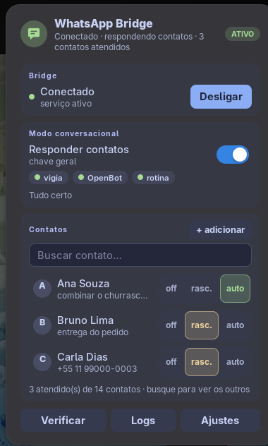

# WhatsApp Bridge — indicador do GNOME Shell

Ícone na barra superior para ligar e desligar o bridge do WhatsApp (whatsmeow) do
[wpp-mcp](../README.md) sem deixar o serviço sempre ativo. Mostra o estado (ligado,
desligado, conectando, erro) e controla o serviço `systemd --user`.



## O painel (0.3.0)

Um painel único, no padrão visual da família "Indicator" (mesmo do NitroSense), em cartões:

- **Cabeçalho** — avatar, nome e pílula de estado (ligado, desligado, conectando, erro).
- **Bridge** — liga/desliga o serviço `whatsapp-bridge.service` (`systemd --user`).
- **Modo conversacional** — chave geral e chips do que está ativo: vigia, OpenBot e rotina.
- **Contatos** — a agenda começa vazia e é montada aos poucos (o agente pergunta e registra); só os contatos atendidos aparecem; busque para ver os outros. Clique num contato para escolher **off / rascunho / auto** (automático pede confirmação) e escrever o **assunto da conversa**.
- **Rodapé** — Verificar (`wpp doctor`), Logs e Ajustes.

Os dados vêm do comando **`wpp`** (`agenda --full`, `contact`, `auto`, `doctor`), não do MCP — o MCP está arquivado em `_arquivo/mcp/` e o indicador não depende dele.

### Como não pesa

Sem polling com o menu fechado: o estado do serviço chega pelo D-Bus do systemd (`PropertiesChanged`) e a agenda por um monitor de arquivos. Com o menu aberto, a verificação roda sob demanda.

### Módulos

| Arquivo | Papel |
|---|---|
| `extension/logic.js` | lógica pura (estado, filtros, chips, textos) — testada com `node --test` |
| `extension/wpp.js` | chama o `wpp` e trata o JSON |
| `extension/bridge.js` | serviço systemd, `/api/status` |
| `extension/extension.js` | interface (St) |
| `extension/prefs.js` | preferências: posição, caminho do `wpp`, intervalo, notificações |

## Instalação

```bash
cd gnome-indicator
./install.sh
gnome-extensions enable whatsapp-bridge@eltobsjr.gmail.com
```

No Wayland, faça logout/login depois de instalar ou atualizar.

### Tema e opções (escolhidos na instalação)

O `./install.sh` pergunta no terminal, antes de copiar qualquer coisa:

- **Paleta**: Catppuccin Macchiato (padrão), Frappé ou Mocha, com uma prévia em cores.
- **Cor de destaque**: 12 opções, ou **seguir o destaque do GNOME** (47+).
- **Opções da extensão**: posição, avisos e intervalo de verificação.

Nenhuma cor fica escrita no código: o `stylesheet.css` é gerado na instalação a partir da paleta que você escolheu.
Para refazer as escolhas, rode `./install.sh --reconfigure`. Sem terminal (CI, `curl | bash`) ou com `--yes`,
vale o que já estava salvo ou o padrão. Também aceita `--palette macchiato|frappe|mocha`, `--accent blue|mauve|…` e `--system-accent`.
Detalhes do padrão visual em [`docs/DESIGN.md`](docs/DESIGN.md).

## Desenvolvimento

`make check` roda sintaxe, schema, tema (3 paletas × 4 destaques), contraste e os 12 testes de `logic.js`; `make pack` gera o .zip; `make clean` limpa.\n\nDepois de `./install.sh --yes`, saia e entre na sessão (no Wayland o JS só recarrega assim). O prefs.js não tem print: é uma janela libadwaita simples.

## Licença

MIT, como o restante do wpp-mcp.

